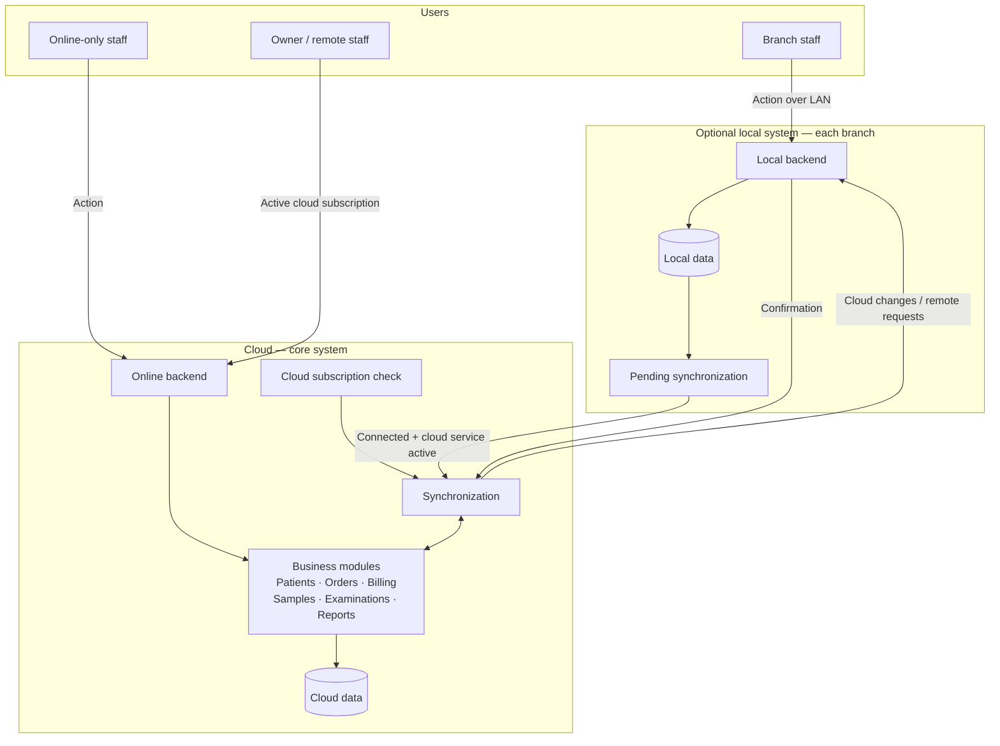

# High-level architecture

The cloud is the core system. Online + Offline adds a local system at each branch. Frameworks, libraries, and infrastructure choices are outside this document.

## System overview

## Behavior

| Situation | Behavior |
| --- | --- |
| Online-only | Actions run directly in the cloud; an active subscription is required |
| Local branch action | Validate and save locally first, then queue for synchronization |
| Internet unavailable | Local work continues; changes wait for reconnection |
| Cloud subscription expired | Permanent local use continues; cloud access and synchronization stop after the agreed grace period |
| Remote action for a local branch | Proposed: remains pending until the responsible branch applies and confirms it |

Local operations must not depend on an immediate cloud subscription check. Cloud service entitlement and local software upgrade coverage are separate.

## Proposed data ownership

- The cloud controls organization-wide settings.
- Each local branch controls its transactions.
- Remote changes to branch transactions are requests until the branch confirms them.
- Synchronization retries must not create duplicate transactions.

These ownership and remote-action rules remain proposals. Shared patient identities, record-level permissions, synchronization conflicts, and recovery procedures need further discussion.

## Deployment scope

One organization can have multiple branches. The local-system block repeats for each branch using Online + Offline. The diagram shows logical components, not separate services or a final database design.

See [plan comparison](../marketing/plans.md) for commercial terms.
