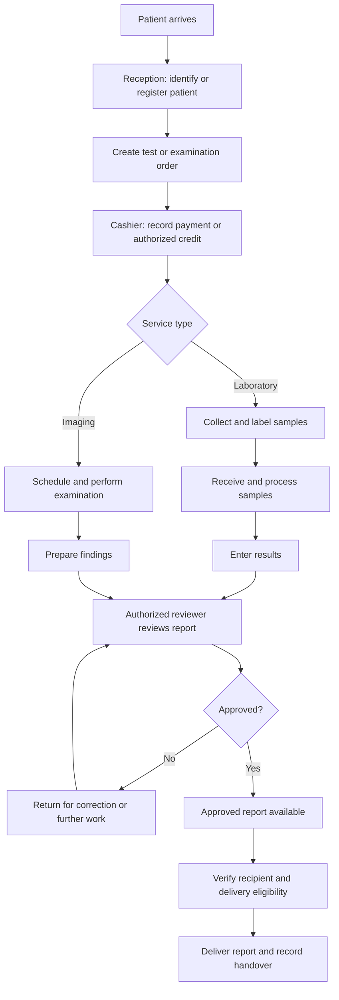
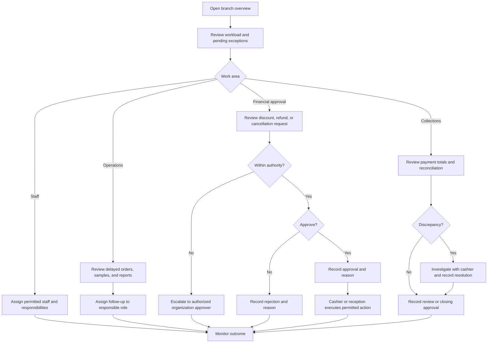
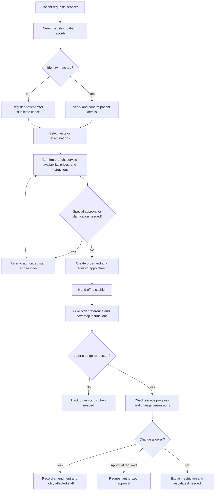
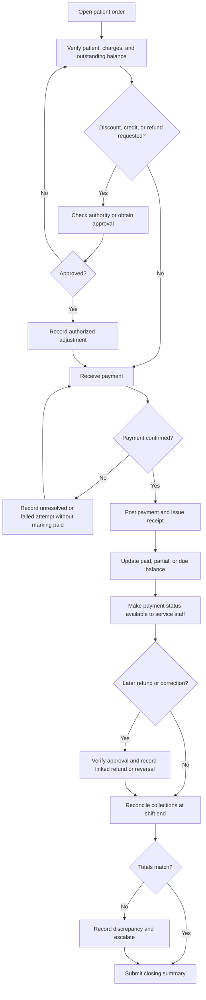
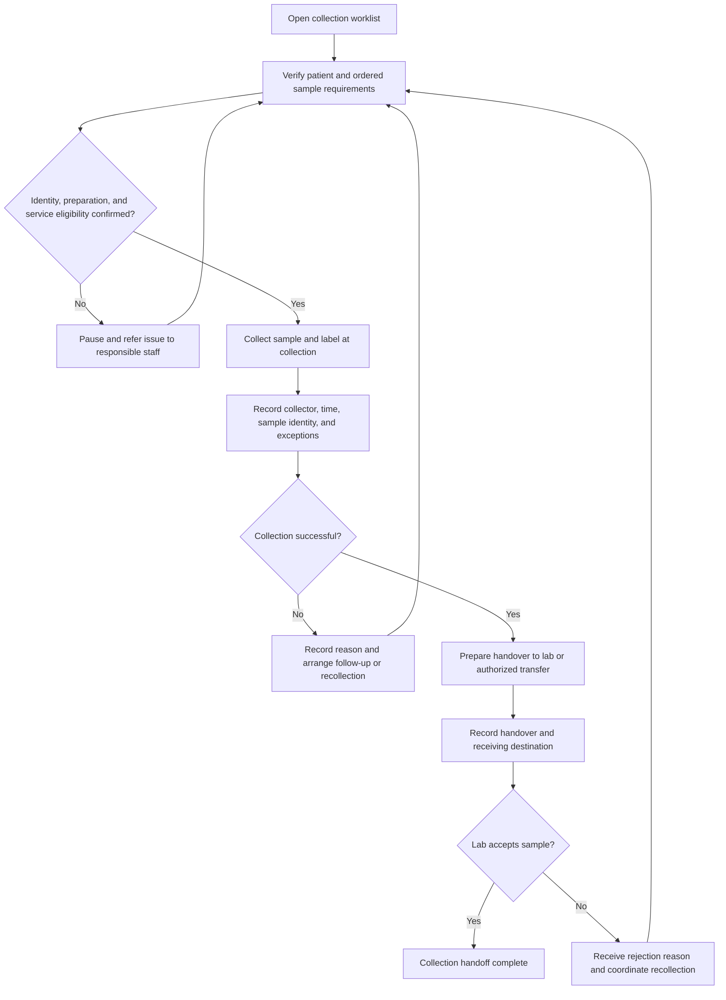
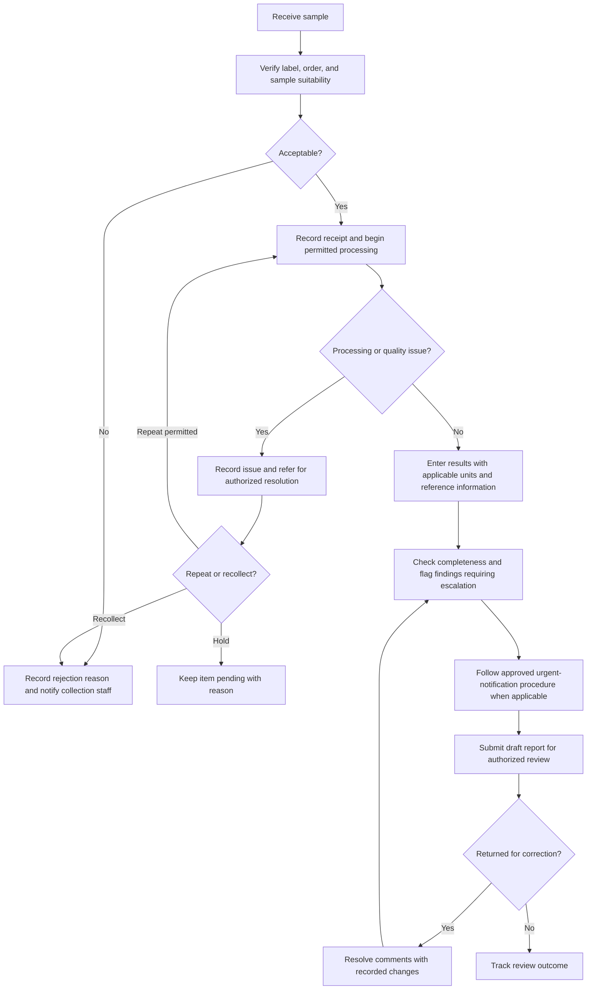
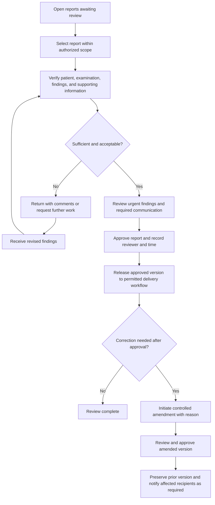
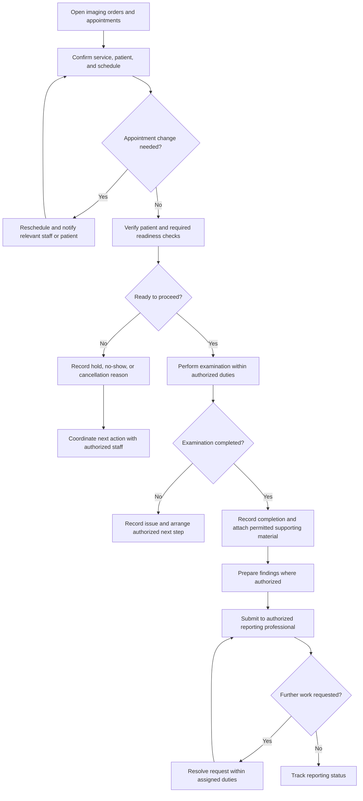
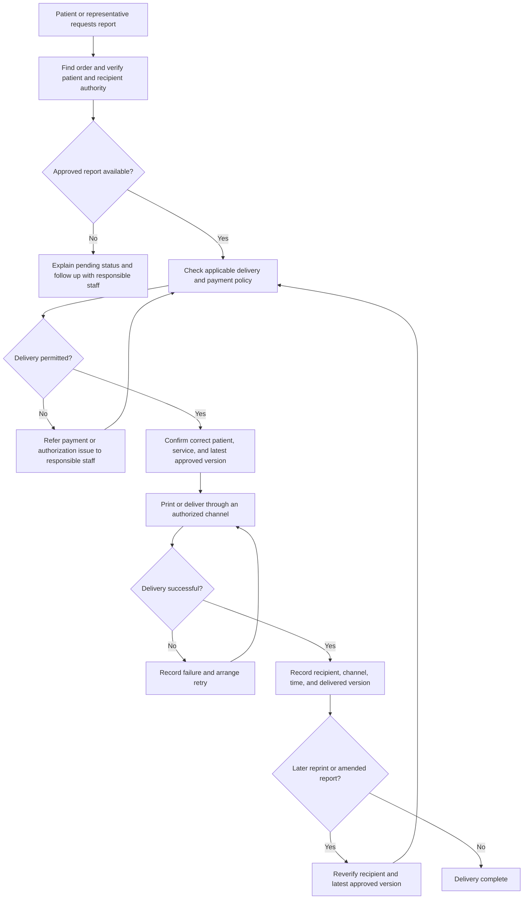

# Branch role user journeys

**Status: Proposed workflows for discussion.** These diagrams cover the eight branch roles, their handoffs, and common exceptions. They are not finalized operating procedures or an exhaustive permission specification.

All users sign in, select an assigned branch, and see only permitted actions. One employee may hold several roles. Actions and approvals are recorded against individual accounts.

## Overall patient journey

Payment eligibility, clinical authorization, and report release rules must be configurable and agreed. An order may contain several services that progress independently; collection, examination, and report readiness are tracked per item.

## 1. Branch manager

Management authority does not grant clinical report approval. Financial limits and closing procedures remain to be defined.

## 2. Receptionist

Do not silently replace patient identity or completed order items. Paid changes may require cashier adjustments; cancellations may require approval.

## 3. Cashier

Refunds and reversals preserve the original transaction history. Permitted partial-payment and credit policies remain open.

## 4. Sample collector

Sample verification and rejection rules must be agreed with authorized clinical/laboratory personnel. Cross-branch transfers require a separately defined tracking workflow.

## 5. Lab technologist

Technologist result entry does not automatically grant final approval. Quality control, urgent findings, and repeat-test procedures require clinical definition.

## 6. Reporting doctor / authorized reviewer

Approval is limited by professional authorization and report type, not management status. Signature, release, amendment, and urgent-notification rules remain to be agreed.

## 7. Imaging staff

Imaging staff is a role group; scheduling, performing an examination, drafting findings, and approving a report may belong to different people and permissions.

## 8. Report delivery staff

Delivery staff cannot edit clinical findings or approve reports. Recipient verification, digital delivery consent, and release conditions remain to be defined.

## Common rules across journeys

- Clinical authorization, financial approval, and branch access are separate permissions.
- Combining roles must not bypass required approvals.
- Holds, cancellations, reversals, and amendments preserve history and record reasons.
- In Online-only, actions run through the cloud. In Online + Offline, branch actions save locally first; synchronization follows connectivity and cloud entitlement.
- Pending synchronization must be distinguishable from completed local work. Do not ask staff to recreate an order or payment merely because synchronization is delayed.
- Cloud-based requests for local branch transactions follow the proposed ownership and confirmation rules in the architecture document; these are not yet finalized.

## Discussion still needed

Detailed journeys for cross-branch referrals and sample transfers, outsourced services, home collection, inventory, organization-level users, and platform administrators are outside these branch-role diagrams. We must also agree on order/item states, partial completion and delivery, identity corrections, approval limits, report authorization, and downtime recovery.

[Branch roles](branch-roles.md) · [High-level architecture](../architecture/high-level.md)
