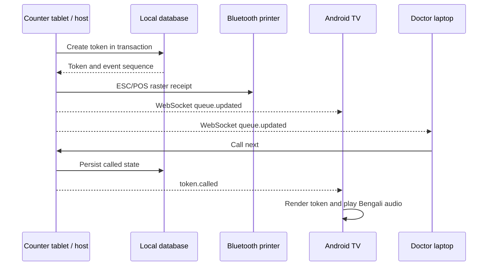
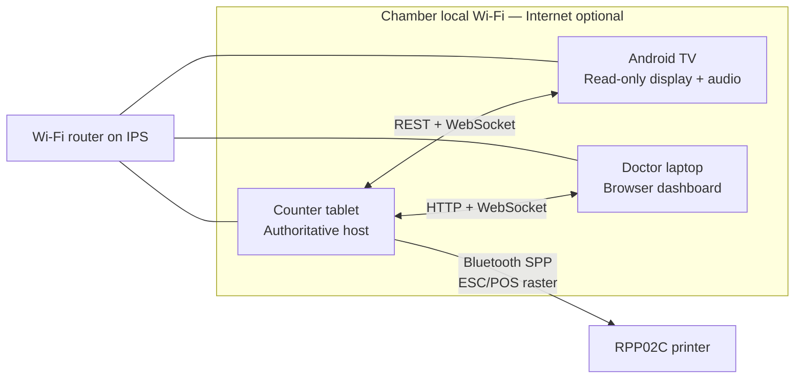

# Patient Serial Management System — R&D Architecture

> **Canonical architecture workspace:** [../architecture/](../architecture/) — use `overview.md`, ADRs, and `open-questions.md` to finalize; this file remains the detailed R&D reference.

Status: proposed architecture for discussion  
Research date: 20 October 2026  
Primary operating mode: local network, fully usable without Internet

## 1. Executive recommendation

Use the **counter Android tablet as the local host and single source of truth** for each active chamber session.

- The tablet creates patients/tokens, stores the queue in a local SQLite database, prints through Bluetooth, and exposes a small local API.
- The Android TV runs a display app. It receives queue events over the chamber Wi-Fi and renders the queue itself; this is data synchronization, not screen casting or video streaming.
- The TV makes announcements through its built-in speaker using bundled Bengali recordings as the dependable option, with an installed offline Bengali TTS voice as an optional fallback.
- The doctor's laptop opens a dashboard served by the tablet over the same local Wi-Fi. No Internet or cloud server is needed.
- Each chamber's router only provides the local network. Moving to another chamber does not change the data authority because the host tablet, database, and printer travel with the doctor.

This is the smallest architecture that fits the listed hardware. Its main limitation is that the system is unavailable if the tablet is off or broken. A future dedicated mini-server can remove that single point of failure, but it is not needed for the first deployment.

## 2. Answers to the four main questions

### 2.1 How should the offline-first system be designed?

Keep all runtime dependencies on the local devices:

1. Store the authoritative queue in SQLite on the tablet.
2. Run an embedded HTTP/WebSocket server in the tablet app.
3. Let TV and laptop obtain a full queue snapshot when they connect.
4. Push subsequent changes as ordered WebSocket events.
5. Bundle all UI assets, Bengali fonts, and announcement audio in the apps.
6. Send printable Bengali text as a raster image to the printer.
7. Use Internet only for optional software updates or encrypted backup—not for normal clinic operation.

Only the tablet may allocate a serial number. This avoids duplicate numbers and data conflicts.

### 2.2 Which device should act as host?

**Recommended host: the Android tablet.**

Reasons:

- It is already the device that creates patients and prints tokens.
- It travels to both chambers, so the live database travels with the doctor.
- The TV should remain a replaceable, read-only display.
- The laptop may be closed, sleeping, updating, or absent.
- Printer communication remains local to one Android application.

Operational requirement: while a clinic session is open, keep the tablet app in the foreground and the tablet charging. If the app must continue serving while minimized, use an Android foreground service with a visible notification. Android documentation distinguishes this from a wake lock; a permanent wake lock should not be used.

Do not make the TV the host. A TV is fixed to one chamber, has inconsistent vendor firmware, and is awkward for backup and administration.

### 2.3 How will the TV update live and announce?

The TV does not need to receive a mirrored screen.



The protocol should include:

- `GET /api/v1/snapshot` — full current state after connection/reconnection.
- `POST /api/v1/tokens` — create a token using a unique request ID.
- `POST /api/v1/tokens/{id}/call` — call or recall a token.
- `POST /api/v1/tokens/{id}/complete|skip|cancel` — queue transitions.
- `/ws` — events such as `token.created`, `token.called`, and `queue.updated`.
- Monotonically increasing `eventSequence`, `sessionId`, and `chamberId` on every event.
- Heartbeat and automatic reconnect with exponential backoff.
- If an event sequence is missed, discard partial client state and fetch a fresh snapshot.

The TV should show a clear **Disconnected—last update at …** state instead of continuing to look live. On reconnection it must refresh before announcing anything, so an old call is not repeated.

### 2.4 Will the Rongta RPP02C work with the Android tablet and print Bengali?

**Android connection: yes, subject to testing the purchased unit.** Rongta lists the RPP02C with Bluetooth/USB, ESC/POS, Android SDK support, 48 mm printable width, and 203 dpi. Its manual lists dual-mode Bluetooth 5.2 (SPP + BLE), Android compatibility, and a nominal range up to 10 m. For this use, Bluetooth Classic SPP plus raw ESC/POS bytes is the simplest path.

There is one vendor inconsistency: Rongta's generic Android SDK download list does not currently name RPP02C even though the product page says Android SDK is supported. Therefore, do not make the application dependent on the proprietary SDK. Use the documented ESC/POS interface and run a proof-of-hardware test before buying multiple printers.

**Bengali printing: yes, by rasterizing it.** Do not assume the printer's built-in character tables contain Bengali or perform Bengali glyph shaping. Instead:

1. Bundle an open Bengali font such as Noto Sans Bengali in the tablet app.
2. Shape and draw the complete token receipt to a monochrome bitmap on Android.
3. Scale/dither it to **384 dots** (48 mm at 203 dpi).
4. Send it using an ESC/POS raster/bit-image command.

This makes output independent of printer code pages and preserves Bengali conjuncts. It is slower than native text but token receipts are short, so the trade-off is appropriate. A printer self-test and a real sample receipt must be part of acceptance testing.

For Android 12+, the app needs runtime `BLUETOOTH_SCAN` when discovering and `BLUETOOTH_CONNECT` when communicating with a paired printer. Discovery can alternatively use Android's Companion Device Manager.

## 3. Component architecture



### Tablet application

Responsibilities:

- Queue commands and validation.
- SQLite database and transactionally assigned serial numbers.
- Embedded local HTTP/WebSocket server.
- Bluetooth pairing, reconnect, receipt rendering, and print status.
- Chamber/session selection.
- Device-pairing screen with QR/PIN and current local URL/IP.
- Local export, encrypted backup, and restore.
- Health panel: TV connected, laptop connected, printer connected, audio-ready state reported by TV.

Suggested Android stack:

- Kotlin and Jetpack Compose.
- Room/SQLite for persistence.
- Ktor or another small embedded server for REST/WebSocket.
- Android `NsdManager` for DNS-SD/mDNS advertisement, for example `_clinic-serial._tcp`.
- Native Android Bluetooth APIs and raw ESC/POS commands.

### Android TV application

Responsibilities:

- Pair with one currently active tablet host.
- Request a snapshot and subscribe to events.
- Render current token, waiting list, doctor/chamber name, and connection health.
- Play announcements and allow recall without double-playing reconnection events.
- Stay in kiosk/foreground mode and set `FLAG_KEEP_SCREEN_ON` so Android TV does not enter ambient mode during a session.

The app should remember a clinic identity, not a tablet IP address. IP addresses can change between routers.

### Laptop dashboard

For the first version, serve the dashboard HTML/CSS/JavaScript directly from the tablet. The doctor opens the URL or scans/copies it from the tablet. Because all assets come from the tablet, this works with no Internet.

The laptop is a client, not a second database. Commands such as **Call next**, **Recall**, **Complete**, and **Skip** go back to the tablet. Use a paired, role-limited session token; do not expose an unauthenticated control page to every Wi-Fi client.

If automatic discovery from a browser proves inconsistent on Windows, show both:

- a QR code containing the current `http://<tablet-ip>:<port>` URL; and
- a short manual address/IP fallback.

Do not depend only on a `.local` hostname.

### Router and power

Use a private WPA2/WPA3 SSID for clinic devices, not a guest Wi-Fi SSID.

Required router settings:

- Tablet, TV, and laptop must be on the same LAN/subnet.
- Disable AP/client/wireless isolation; it blocks clients from reaching each other.
- Permit multicast/mDNS (UDP 5353) for discovery.
- Use DHCP. A reservation for the tablet is convenient but cannot be relied upon across both chambers.
- Place router and TV power on IPS if announcements must survive load shedding.
- Keep the tablet and printer charged; IPS for only the router does not keep the full system alive.

Internet loss should have no operational effect. Router power loss temporarily disconnects TV/laptop, but queue creation and printing continue on the tablet and clients recover from a snapshot after Wi-Fi returns.

## 4. Reliable Bengali announcements

Android supports Bengali locales through the `TextToSpeech` API, and Google documents Bangla (Bangladesh) among supported languages. However, availability depends on the TV's installed TTS engine and voice data. A voice may also require a network connection.

For a dependable clinic system, use this order:

1. **Primary:** bundle human-recorded Bengali clips for the fixed phrase and the supported token-number range, for example 1–500.
2. **Secondary:** use an installed `bn-BD` voice only after the TV app verifies that it exists and `Voice.isNetworkConnectionRequired()` is false.
3. **Failure behavior:** show the called token visually and report “audio unavailable” to the tablet; never delay the queue command.

Example phrase:

> সিরিয়াল নম্বর ১২৫, দয়া করে ডাক্তারের কক্ষে আসুন।

At installation, test while the Internet/WAN is disconnected. The TV setup screen should include volume, selected voice, “play test announcement,” and an audio readiness result. If human recordings are used, obtain and record them specifically for the app; do not extract or redistribute a vendor's TTS voice files.

## 5. Two-chamber operating model

Create persistent **Chamber A** and **Chamber B** profiles on the tablet. Each contains:

- chamber ID and Bengali/English display name;
- doctor name and receipt heading;
- default starting token number and daily limit;
- paired TV identity;
- optional receipt footer and announcement phrase.

Recommended workflow at each chamber:

1. Power the chamber router/TV and connect the travelling tablet/laptop to that chamber's SSID.
2. Select the chamber on the tablet.
3. Start a new session for the date/shift.
4. The tablet advertises itself on that LAN.
5. The TV discovers it. On first use, confirm a one-time PIN/QR code shown on both devices.
6. Run health checks: TV live, audio test passed, printer connected, test print passed.
7. Operate the queue.
8. End and archive the session before leaving.

The printer is paired directly to the tablet, so changing Wi-Fi routers does not affect printing. Bluetooth pairing normally persists.

The TV pairing record should be scoped by `clinicId + chamberId + deviceId`; it must not accept the wrong chamber automatically. A session nonce prevents an old TV from replaying or showing a previous session.

If both chambers must operate **at the same time**, this design with one travelling tablet is insufficient. Each concurrent chamber needs its own host tablet or fixed local server. Cloud synchronization can later provide cross-chamber reporting, but it should not be in the critical path for issuing tokens.

## 6. Data and consistency model

Minimum records:

- `Clinic`
- `Chamber`
- `ClinicSession` — chamber, date/shift, opened/closed time, next number
- `Token` — UUID, display number, state, timestamps, optional minimal patient reference
- `QueueEvent` — sequence, command ID, type, payload, timestamp
- `PairedDevice` — device identity, role, chamber, revoked status
- `AppSetting` and `BackupRecord`

Token state flow:

```text
WAITING -> CALLED -> ENTERED
WAITING -> CANCELLED
CALLED  -> CANCELLED
CALLED  -> SKIPPED -> CALLED
```

`ENTERED` means the patient entered the doctor's chamber and is the queue's successful terminal state. Consultation completion is outside the queue system's scope. This accepted rule is detailed in [Patient entry and queue operations](../features/patient-entry-and-queue-operations.md).

Rules:

- Allocate the next number inside one database transaction.
- Every write request carries an idempotency/command ID so a retry cannot create a duplicate patient.
- Persist the event before notifying connected clients.
- TV is read-only.
- Laptop commands are authorized and validated by the tablet.
- Keep an append-only event/audit trail for recovery and troubleshooting.

Collect the minimum patient data needed. The waiting-room TV and printed token should normally show only the serial number, not a patient's name, phone number, diagnosis, or visit reason.

## 7. Failure handling

- **Internet unavailable:** no impact.
- **TV disconnects:** tablet continues; TV shows disconnected state, then fetches a snapshot on return.
- **Laptop disconnects/sleeps:** counter tablet continues; dashboard reloads from the tablet.
- **Printer disconnects or is out of paper:** token remains created with print status `FAILED`; allow explicit reprint without creating a new token.
- **Router fails:** tablet can continue token entry and printing. TV/laptop reconnect after router recovery.
- **Tablet app restart:** restore the open session from SQLite and resume the same `eventSequence`.
- **Tablet failure/loss:** restore the last encrypted export on a replacement tablet; tokens after the last backup may be lost. This is the accepted first-version single point of failure.
- **Power interruption:** SQLite uses transactions/WAL; on restart, validate the open session and printer state before resuming.

Provide a manual paper-token fallback procedure at both chambers. No digital architecture removes the need for an operational fallback in a clinic.

## 8. Security and privacy baseline

- Dedicated WPA2/WPA3 clinic SSID with a non-default router password.
- Pair devices with an expiring PIN/QR challenge; do not trust “same Wi-Fi” alone.
- Separate read-only TV credentials from doctor-control credentials.
- Random high-entropy session tokens; revoke lost devices.
- Encrypt backups and keep secrets in Android Keystore.
- Auto-lock administrative screens, but keep the public queue view visible.
- Store no clinical notes in version 1.
- Keep an audit entry for create, call, skip, cancel, reprint, session start/end, and settings changes.

Local HTTP is acceptable only on the controlled chamber LAN when combined with application pairing tokens and strict network setup. If patient-identifying data is added later, perform a privacy/security review and consider authenticated TLS or packaged clients rather than expanding the plain local web interface.

## 9. Proof-of-concept and acceptance plan

Do not commit to the complete application until these risks are tested with the exact tablet, TV, and printer models.

### Hardware spike

1. Pair the RPP02C from Android 12+ and reconnect after printer/tablet restart.
2. Print a 384-dot Bengali test receipt containing vowel signs, conjuncts, Bengali digits, English digits, QR code, bold/large serial, and a long clinic name.
3. Verify output while the tablet is offline and with the printer near 10% battery.
4. Install the TV APK, keep it open for a full clinic shift, and verify no ambient mode or vendor task killer interrupts it.
5. Test Bengali audio in airplane/offline mode.
6. Test the same tablet on both chamber routers.

### Network and recovery spike

1. Create 100 tokens and verify no duplicate numbers.
2. Turn the TV Wi-Fi off during calls, reconnect it, and confirm one snapshot with no repeated announcements.
3. Restart the tablet app mid-session and continue numbering.
4. Power-cycle the router and confirm automatic TV recovery.
5. Retry the same token-creation request and confirm idempotency.
6. Verify a non-paired Wi-Fi client cannot control the queue.

### Go/no-go criteria

- Bengali sample is readable and correctly shaped.
- A print succeeds in under an agreed threshold, suggested 5 seconds.
- TV receives a call under an agreed local target, suggested 500 ms in normal Wi-Fi conditions.
- Offline announcement is understandable at waiting-room volume.
- All three devices recover from router interruption without data loss or duplicate announcement.
- Staff can switch chambers using a written checklist without developer assistance.

## 10. Delivery phases

### Phase 1 — hardware proof

Printer spike, Bengali bitmap receipt, TV offline audio, and local WebSocket test.

### Phase 2 — minimum usable clinic

Tablet host, queue database, token creation/reprint, TV display/announcement, laptop control page, chamber profiles, pairing, and session close.

### Phase 3 — hardening

Backups/restores, audit log, recovery UX, device revocation, health dashboard, long-shift tests, and staff training.

### Phase 4 — optional online services

Encrypted off-site backup, software update channel, aggregate reporting, or multi-host synchronization. None should be required to run a chamber.

## 11. Decision summary

- **Host:** counter tablet.
- **Authority:** one SQLite database on the tablet.
- **Live update:** local REST snapshot + WebSocket events, not screen casting.
- **Discovery:** Android NSD/mDNS with QR/IP fallback.
- **Printer:** RPP02C over Bluetooth Classic SPP using raw ESC/POS.
- **Bengali print:** render with bundled Bengali font to a 384-dot raster image.
- **Bengali voice:** bundled recordings first; verified offline `bn-BD` TTS second.
- **Laptop:** browser dashboard served by the tablet.
- **Two chambers:** persistent profiles and fixed paired TVs; travelling tablet/database/printer; re-discover on each LAN.
- **Internet:** optional, never in the queue's critical path.

## 12. Research sources

Primary/vendor sources were preferred for hardware and Android behavior:

1. Rongta, **RPP02C product specifications** — ESC/POS, Bluetooth/USB, 48 mm width, 203 dpi, and stated Android SDK support:  
   https://www.rongtatech.com/rpp02c-58mm-thermal-mobile-receipt-printer_p127.html
2. Rongta, **RPP02C User Manual V1.0** — Bluetooth 5.2 SPP + BLE, Android compatibility, default pairing details, and printer parameters:  
   https://file.globalso.com/file_manage/4365/20251121/rpp02c-user-manual_v1-0_en.pdf
3. Rongta, **Android SDK model list** — checked because the current generic list does not explicitly include RPP02C:  
   https://www.rongtatech.com/sdk/
4. Android Developers, **Bluetooth permissions** — Android 12+ scan/connect runtime permissions:  
   https://developer.android.com/develop/connectivity/bluetooth/bt-permissions
5. Android Developers, **Network Service Discovery** — DNS-SD/mDNS local service advertisement and discovery:  
   https://developer.android.com/develop/connectivity/wifi/use-nsd
6. Android Developers, **TextToSpeech API** — language availability, voices, and runtime synthesis:  
   https://developer.android.com/reference/android/speech/tts/TextToSpeech
7. Android Developers, **Voice API** — identifying whether a voice requires a network connection:  
   https://developer.android.com/reference/android/speech/tts/Voice
8. Google Android Accessibility Help, **TalkBack supported languages** — includes Bangla (Bangladesh) and Bangla (India), with a device-availability caveat:  
   https://support.google.com/accessibility/android/answer/11101402
9. Android Developers, **Keep the screen on** — `FLAG_KEEP_SCREEN_ON`, including Android TV ambient-mode behavior:  
   https://developer.android.com/develop/background-work/background-tasks/awake/screen-on
10. Android Developers, **Wake lock best practices** — foreground/background operating constraints:  
    https://developer.android.com/develop/background-work/background-tasks/awake/wakelock/best-practices
11. Cisco Meraki, **Wireless Client Isolation** — isolation prevents wireless clients from communicating:  
    https://documentation.meraki.com/Wireless/Operate_and_Maintain/How_Tos/Firewall_and_Traffic_Shaping/Wireless_Client_Isolation

Hardware claims describe the vendor's published specifications. Actual Bengali output, Android firmware behavior, Bluetooth stability, and offline voice availability remain device-specific and must be proven by the acceptance tests above.
